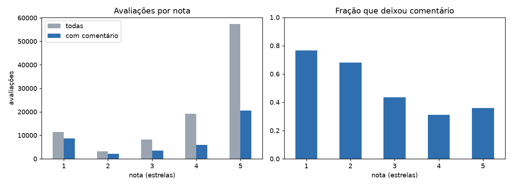
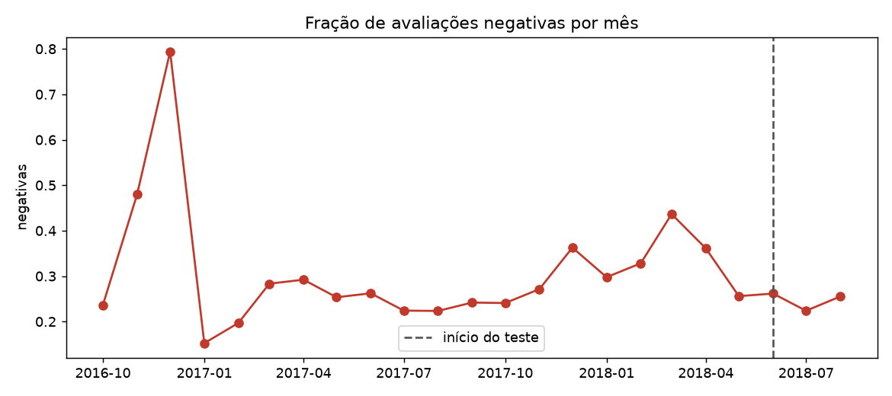
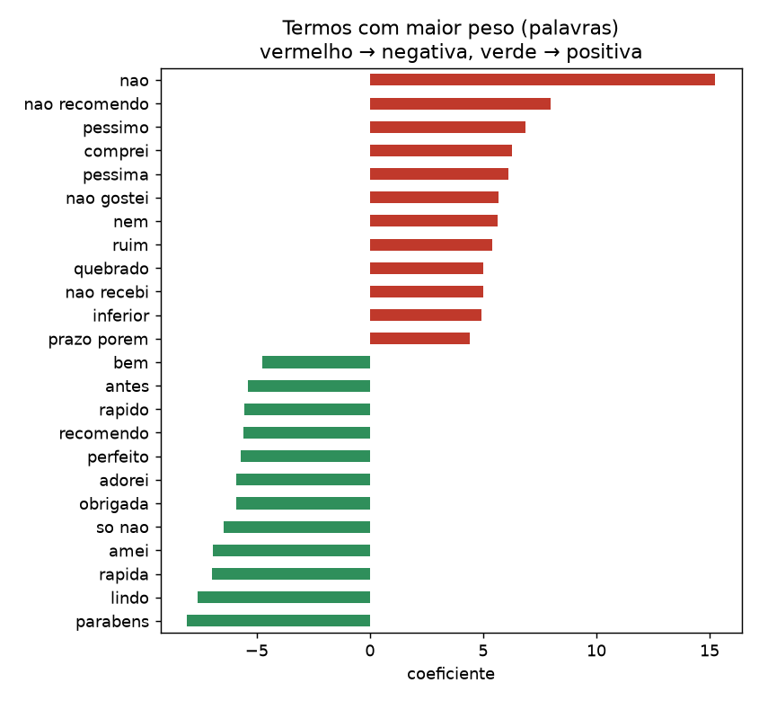
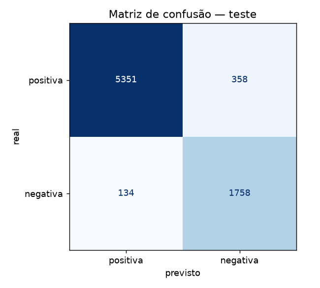
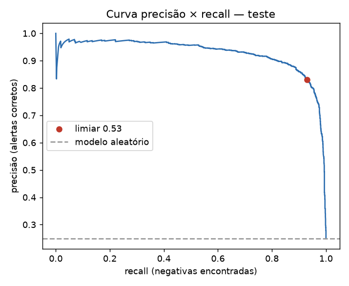

# Triagem de avaliações de clientes com Aprendizagem de Máquina

Classificador de sentimento para comentários de clientes de e-commerce em português, que separa **reclamações** de **elogios** para que uma equipe de atendimento priorize quem está insatisfeito.

> Projeto N3 — Aprendizagem de Máquina. Entrega: 08/12/2026.

## 1. Problema e dados

**Objetivo.** Dado o texto de uma avaliação, estimar a probabilidade de ela ser uma reclamação e explicar quais termos levaram à decisão.

**Quem usaria.** Equipes de atendimento/SAC e de qualidade de marketplaces e lojas online. Hoje uma pessoa precisaria ler cada comentário. O modelo ordena a fila e põe as reclamações prováveis no topo (prioridade alta, média ou baixa).

**Fonte.** [Brazilian E-Commerce Public Dataset by Olist](https://www.kaggle.com/datasets/olistbr/brazilian-ecommerce) (Kaggle, licença CC BY-NC-SA 4.0), arquivo `olist_order_reviews_dataset.csv`. São 99.224 avaliações reais de pedidos feitos entre out/2016 e ago/2018, cada uma com nota de 1 a 5 estrelas e um comentário opcional.

**Rótulo.** O dataset não tem um rótulo de sentimento. Ele foi derivado da nota que o próprio cliente deu: 1–2 estrelas viram **negativa** (reclamação) e 4–5 estrelas viram **positiva**. A nota 3 é ambígua e ficou fora do treino. Ela é analisada à parte na seção 4.

## 2. Exploração e preparação

| Etapa | Avaliações | Observação |
|---|---:|---|
| CSV original | 99.224 | |
| Com comentário utilizável | 40.482 | 58,7% não escreveram nada; também removemos `review_id` duplicado e comentários sem nenhuma letra (".", "10") |
| Rotuladas (sem nota 3) | 36.964 | 29,1% negativas, um desbalanceamento moderado |
| **Treino**: out/2016 → mai/2018 | 29.363 | 30,2% negativas |
| **Teste**: jun/2018 → ago/2018 | 7.601 | 24,9% negativas |



Achados da exploração e como cada um virou uma decisão:

- **Quem dá nota baixa escreve mais.** A nota 1 tem comentário em cerca de 75% dos casos, contra cerca de 35% na nota 5. Por isso as reclamações são ~29% do conjunto com texto, contra ~15% no CSV inteiro. O modelo só se aplica a quem escreveu, que é exatamente o caso de uso.
- **Os comentários são curtos** (mediana de 9 palavras) e cheios de variações de escrita: "Ótimo", "otimo" e "Otimo" estão entre os 10 textos mais comuns. Por isso o texto é **normalizado**: minúsculas, sem acento e com espaços colapsados (`src/data.py`).
- **Stop words NÃO foram removidas.** A lista de stop words do português contém "não", e "não recebi" × "recebi" é justamente a diferença entre as classes. Pelo mesmo motivo usamos **bigramas** ("nao recebi", "nao recomendo").
- **A proporção de negativas muda com o tempo.** Em 2016 ela oscila muito, porque há poucas avaliações; de 2017 em diante fica entre 15% e 44% por mês, com pico em mar/2018 (figura abaixo). Por isso a divisão é **temporal**: o modelo é treinado com o passado e testado nos três meses mais recentes, como aconteceria em produção. Uma divisão aleatória misturaria reviews do mesmo período (mesmos produtos, mesmas greves) nas duas metades e daria um resultado otimista.



## 3. Modelagem

Todos os modelos foram comparados com **validação cruzada estratificada de 5 folds dentro do período de treino**. O teste foi usado uma única vez, no final. A métrica de escolha é a **PR-AUC da classe negativa** (precisão média): ela mede o quanto o modelo põe as reclamações no topo da fila, não depende de um limiar e não é inflada pela classe majoritária como a acurácia.

| Modelo (CV, treino) | PR-AUC | F1 (negativa) |
|---|---:|---:|
| Dummy (sempre "positiva") | 0,302 | 0,000 |
| Regra de palavras-chave ("não recebi", "defeito", "péssimo"…) | 0,567 | 0,631 |
| TF-IDF palavras + Naive Bayes | 0,928 | 0,871 |
| **TF-IDF palavras (1–2-gramas) + Regressão Logística** | **0,937** | **0,891** |
| TF-IDF palavras + caracteres + Regressão Logística | 0,937 | 0,892 |
| TF-IDF palavras + caracteres + SVM linear | 0,935 | 0,894 |

**Principais escolhas:**

- **Regressão Logística com TF-IDF de palavras.** Os três modelos lineares empataram tecnicamente (diferença < 0,002 de PR-AUC). Escolhemos o mais simples, pelos seguintes motivos:
  - treina em 3 s, contra 19 s com n-gramas de caracteres;
  - é interpretável: cada termo tem um peso, e a demo mostra exatamente quais termos decidiram;
  - devolve uma probabilidade calibrada, o que o SVM não faz.
- **`class_weight="balanced"`** compensa os 30% de negativas, para o modelo não favorecer a classe majoritária.
- **O limiar de decisão (0,53) foi escolhido nas previsões *out-of-fold* do treino**, maximizando o F1 da classe negativa, e não no teste, para não vazar informação.
- Os baselines mostram o ganho do ML: a regra de palavras-chave, que seria o que uma pessoa faria sem modelo, só encontra 44% das reclamações no teste.



## 4. Avaliação no teste (jun–ago/2018, nunca visto)

| Modelo (teste) | Precisão (neg.) | Recall (neg.) | F1 (neg.) | F1 macro | Acurácia | PR-AUC |
|---|---:|---:|---:|---:|---:|---:|
| Dummy | — | 0,000 | 0,000 | 0,429 | 0,751 | 0,249 |
| Regra de palavras-chave | 0,762 | 0,442 | 0,559 | 0,726 | 0,827 | 0,476 |
| **Reg. Logística (limiar 0,53)** | **0,831** | **0,929** | **0,877** | **0,917** | **0,935** | **0,928** |

ROC-AUC no teste: 0,977.

**Interpretação.** De cada 100 reclamações reais, o modelo encontra 93. De cada 100 alertas que ele levanta, 83 são reclamações de fato. O desempenho no teste (PR-AUC 0,928) ficou próximo do da validação cruzada (0,937), mesmo com a mudança de período e de proporção de negativas (30% → 25%). Isso indica que o modelo generaliza e não está sobreajustado.

 

### Erros e limitações

Os exemplos completos estão em [`reports/erros.md`](reports/erros.md).

1. **Muitos "erros" são do rótulo, não do modelo.** Entre os falsos positivos com maior confiança estão "Não recebi" e "AINDA NÃO RECEBI O PRODUTO" com **5 estrelas**. Entre os falsos negativos estão "Produto de boa qualidade, entrega dentro do prazo" com **1 estrela**. O cliente deu uma nota que contradiz o próprio texto. Como o rótulo vem da nota, o teto real do modelo é mais baixo do que 100%. Esse ruído também afeta o treino.
2. **Comentários muito curtos são o ponto fraco.** Com 1 a 3 palavras ("ok", "bom"), o F1 da classe negativa cai para 0,68, contra 0,88–0,89 nos demais tamanhos. Não há contexto suficiente para decidir.

   | Palavras | n | F1 (neg.) | Acerto |
   |---|---:|---:|---:|
   | 1–3 | 1.505 | 0,675 | 96,7% |
   | 4–10 | 3.112 | 0,878 | 95,5% |
   | 11–25 | 2.186 | 0,885 | 91,3% |
   | 26+ | 798 | 0,894 | 86,1% |

3. **Comentários mistos** ("entrega rápida, mas o produto é diferente da foto") somam pesos opostos. Um modelo de *bag of words* não entende que o "mas" muda o foco. A demo mostra esse caso.
4. **A nota 3 fica no meio.** Das 694 avaliações nota 3 do período de teste, o modelo marca 57,8% como reclamação. Isso é coerente com a nota 3 ser neutra, mas a solução binária não tem uma classe "neutra".
5. **O domínio é limitado:** e-commerce em 2016–2018. Gírias novas ou outro setor (saúde, serviços) exigiriam retreinar o modelo. Também não há tratamento para ironia.

**Próximos passos:**
- rotular manualmente uma amostra para medir o ruído do rótulo;
- testar um modelo de linguagem pré-treinado em português (ex.: BERTimbau), que lida melhor com negação e contraste;
- adicionar uma classe neutra.

## 5. Demonstração de uso

**Interface (Streamlit).** Digite um comentário e veja o sentimento, a probabilidade, a prioridade e os termos que pesaram na decisão:

```bash
.venv/bin/streamlit run app/app.py
```

**Linha de comando:**

```bash
.venv/bin/python src/predict.py "Até agora não recebi o produto e já passou do prazo"
```

```
Avaliação: NEGATIVA  (probabilidade de ser negativa: 100%)
Prioridade para o atendimento: alta
Termos que mais pesaram:
  nao                       +1.92 → negativa
  passou                    +1.27 → negativa
  nao recebi                +1.00 → negativa
  ...
```

**Como função Python:**

```python
from predict import predict          # com src/ no PYTHONPATH
r = predict("Veio quebrado, quero devolver")
r.label, r.probability_negative, r.priority, r.contributions
```

## 6. Como executar

Requer Python 3.11+.

```bash
python3 -m venv .venv
.venv/bin/pip install -r requirements.txt
.venv/bin/python src/download_data.py   # baixa o CSV do Kaggle para data/ (~42 MB, sem login)
.venv/bin/python src/explore.py         # números da exploração + figuras 01–03
.venv/bin/python src/train.py           # validação cruzada, teste, modelo e figuras 04–06 (~1 min)
.venv/bin/streamlit run app/app.py      # demo
```

O modelo treinado (`models/sentiment.joblib`, < 1 MB) já está versionado. Para rodar só a demo, basta instalar as dependências.

## Estrutura

```
src/data.py           carga, limpeza, normalização, rótulo e divisão temporal
src/explore.py        análise exploratória (figuras 01–03)
src/models.py         modelos candidatos e baselines
src/train.py          validação cruzada, escolha do limiar, teste, relatórios
src/predict.py        previsão + explicação (função e CLI)
src/download_data.py  download do dataset
app/app.py            interface Streamlit
reports/              metrics.json, erros.md, figures/
models/               modelo treinado
```

## Contribuição dos integrantes

| Integrante | Contribuição |
|---|---|
| _Nome 1_ | _ex.: exploração dos dados e preparação_ |
| _Nome 2_ | _ex.: modelagem e validação cruzada_ |
| _Nome 3_ | _ex.: análise de erros e limitações_ |
| _Nome 4_ | _ex.: demo Streamlit e README_ |
